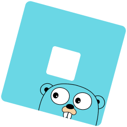

# goblox 
Goblox is a Roblox API wrapper written in Golang to make accessing Roblox's API within your Go projects easy.

Goblox is separated into two separate packages: `opencloud` and `legacy`. The `opencloud` package gives access to all of Roblox's APIs that allow you to use an API key or OAuth2 token. The `legacy` package gives access to all of Roblox's normal/classic APIs, with the additional ability to set a cookie.

> [!CAUTION]
> While this library is used in some production deployments, it is not considered fully stable. If you want to contribute, feel free to open a PR!

## Installation
> [!NOTE]
> Go 1.18 or newer is required.
```sh
go get -u github.com/typical-developers/goblox
```
